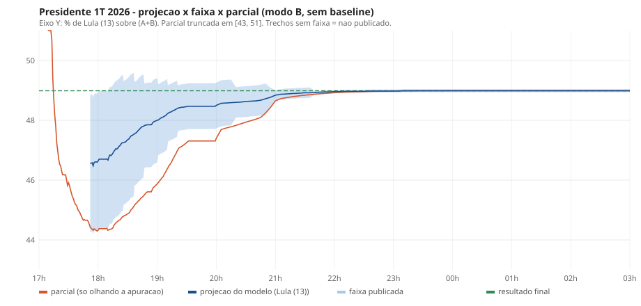

# Validacao cega do modelo no holdout do 1o turno 2026

Gerado por `qa/validacao-1t2026/validar.mjs` + `relatar.mjs` (reprodutivel; sem dependencias). QA independente: nao participou da construcao do modelo nem do backfill, nao editou `model/` nem `backfill/`. Modelo: `model/index.mjs` v2.0.1. Execucao: 2026-10-24T02:22:24.774Z. 265 instantes (17:00 a 03:00), 7 corridas, 2 modos, 3710 avaliacoes; erros de execucao do modelo: 0.

## 1. Veredito

**Veredito (modo B, cego): APROVADO COM RESSALVAS.** Modo A (producao, nao cego): APROVADO COM RESSALVAS.

Regras do veredito (fixadas antes de olhar os resultados):
- REPROVADO se houver qualquer chamada de vencedor errada (C2), ou cobertura do presidente < 80%, ou C3 falhar.
- APROVADO se C1, C2, C3 e C4 passarem.
- APROVADO COM RESSALVAS nos demais casos (C2 e C3 ok, cobertura do presidente entre 80% e 90%, ou alguma UF de governador abaixo de 90%).

Modo B (cego, usado no veredito):

| Criterio | Limite | Resultado | Passa? |
|---|---|---|---|
| C1 Cobertura no presidente | >= 90% | 94,8% | sim |
| C2 Chamadas erradas (tendencia + definido mat., 7 corridas) | = 0 | 0 | sim |
| C3 Presidente: faixas com erro do modelo < erro da parcial | > metade das faixas com publicacao | 11/11 | sim |
| C4 Cobertura >= 90% em cada uma das 6 UFs de governador | todas | 100,0% / 89,5% / 99,1% / 100,0% / 96,9% / 100,0% | NAO |

Modo A (producao, baseline = resultado final do 1T; nao cego, so referencia):

| Criterio | Limite | Resultado | Passa? |
|---|---|---|---|
| C1 Cobertura no presidente | >= 90% | 94,8% | sim |
| C2 Chamadas erradas (tendencia + definido mat., 7 corridas) | = 0 | 0 | sim |
| C3 Presidente: faixas com erro do modelo < erro da parcial | > metade das faixas com publicacao | 11/11 | sim |
| C4 Cobertura >= 90% em cada uma das 6 UFs de governador | todas | 100,0% / 86,7% / 99,1% / 100,0% / 97,7% / 100,0% | NAO |

## 2. Base e metodo (o que exatamente foi medido)

**Adaptacao 1T -> modelo de 2T.** O modelo projeta a participacao de dois finalistas. Foi usado o proprio mecanismo dele: os finalistas vem de `baselines/*.json` (`corrida.finalistas`) e o modelo ignora os demais candidatos; `pct_proj` = A / (A + B) projetado, ou seja, **share entre os dois candidatos, re-normalizado nos votos validos dos dois**. O modelo recebe os arquivos completos (12 candidatos no presidente); ele so soma os votos de A e B.
- **Presidente:** A = LULA (13), B = FLAVIO BOLSONARO (22). Verdade = share de Lula entre Lula e Flavio no arquivo oficial final 6257 (BR) = **48,99%** (vencedor na base de 2: Flavio (22)).
- **Governadores (os 2 primeiros do 1T = finalistas do 2T):** AC: A=MAILZA ASSIS (11) x B=ALAN RICK (10), final de A = 60,66%; AM: A=OMAR AZIZ (55) x B=PROFESSORA MARIA DO CARMO (22), final de A = 62,40%; DF: A=CELINA LEÃO (11) x B=LEANDRO GRASS (13), final de A = 59,16%; ES: A=LORENZO PAZOLINI (10) x B=RICARDO FERRAÇO (15), final de A = 59,31%; RN: A=CADU DE LULA (13) x B=ALLYSON (44), final de A = 49,47%; TO: A=VICENTINHO JÚNIOR (45) x B=PROFESSORA DORINHA (44), final de A = 49,12%. Verdade = arquivo oficial final 6259 da UF (c0003), mesma base A/(A+B).
- **Parcial ("so olhar a apuracao")** = votos de A / (A + B) somados nos arquivos do instante, na mesma base de 2 candidatos. Erro = |valor - final| em p.p.
- **Instantes:** os 265 snapshots do replay. `agora` = horario do snapshot (frescor sempre 0 s: o replay nao tem atraso entre geracao e leitura; o criterio de frescor, portanto, nao foi testado).
- **Ajuste tecnico obrigatorio:** o parser do modelo rejeita `t != '2'` e `ele` diferente do esperado. Cada JSON do replay foi copiado em memoria com `t:'2'` e `entrada.eleicao` = 6257/6259. Nenhum outro campo foi alterado.
- **Presidente:** `entrada.ufs` = 27 UFs + ZZ do replay (estratificacao por UF).
- **Governador:** `entrada.ufs[uf]` = arquivo da UF do replay e `entrada.estratos` = arquivos municipais do replay que existem no instante (municipio sem BU ainda = sem arquivo; o modelo trata como `semDado`).
- **DF (zonas):** o modelo exige zonas no DF (baseline por zona, ids `df97012-zNNNN`). Sem replay zonal, as zonas foram construidas por `lib/df-zonas.mjs` a partir de `secoes-governador-df.csv.gz` (NR_ZONA): para cada instante T, cada zona com >= 1 BU recebido (`dt_bu_recebido <= T`, Brasilia) vira um `-u.json` minimo com `s.ts`/`e.te` = soma de todas as secoes da zona, `s.st`/`e.est` = BUs recebidos, votos = soma dos candidatos (sem o nulo tecnico v_55). O municipal unico do replay do DF foi descartado. Estratificacao efetiva do DF: `governador_zonas`.

**Dois modos.**
- **A = producao como entregue.** O modelo traz `baselines/` gerados do **resultado final do proprio 1T 2026** (`model/tools/gerar-baselines.mjs`). No holdout isso e vazamento: o prior de qualquer estrato ainda sem apuracao e a resposta final dele. Por isso o modo A **nao e cego**.
- **B = cego.** `cfg.usarBaseline=false` (o mesmo modo `M0_1T` que o backtest 2022 usa para 1o turno): estrato sem apuracao usa a taxa agregada observada. Nenhum dado do resultado final entra. O criterio `fallback_nacional` (<= 5% do eleitorado) segue valendo.
- Diferenca A x B: presidente IDENTICO em todos os 265 instantes (publicacao, projecao e faixa); governadores (max |A-B| na projecao; instantes com publicacao diferente): AC 0,00 pp / 0; AM 0,34 pp / 0; DF 0,00 pp / 0; ES 0,12 pp / 0; RN 0,04 pp / 0; TO 0,07 pp / 0. Ou seja, nos instantes publicados quase todos os estratos ja tem apuracao e o prior pouco entra; o vazamento teve efeito pequeno.

**Faixas por % do eleitorado apurado** (campo `apurado.eleitorado_pct` do modelo): 0-10, 10-20, 20-30, 30-40, 40-50, 50-60, 60-70, 70-80, 80-90, 90-95, 95-99, 99-100; limite inferior inclusivo.
**Cobertura** = fracao dos instantes publicados em que o final ficou em [min, max] da faixa publicada do candidato A (valores arredondados a 2 casas, como o modelo publica). **Chamadas de vencedor** = `forecast.tendencia` (so existe com forecast publicado) e `parcial.definido_matematicamente` (calculado pelo modelo mesmo sem forecast publicado); errada = candidato chamado != vencedor final na base de 2.

## 3. Presidente (modo B)

### 3.1 Publicacao

| Corrida | Estratificacao (final) | Publicados / 265 | 1a publicacao | % eleit. apurado na 1a | Despublicacoes | Bloqueios antes da 1a publicacao (instantes) |
|---|---|---|---|---|---|---|
| presidente | presidente | 213 | 17:52 | 10,05 | 0 | apuracao_minima: 52; estratos_apurados: 9; estratos_sem_prior: 9; fallback_nacional: 7 |

### 3.2 Erro e cobertura por faixa de % apurado

| % apurado | Instantes | Publicados | Erro modelo medio (pp) | Erro modelo max (pp) | Erro parcial medio (pp) | Erro parcial max (pp) | Modelo < parcial? | Cobertura | Meia-largura media (pp) |
|---|---|---|---|---|---|---|---|---|---|
| 0-10 | 52 | 0 | — | — | — | — | — | — | — |
| 10-20 | 23 | 23 | 2,315 | 2,509 | 4,626 | 4,693 | sim | 13/23 (56,5%) | 2,290 |
| 20-30 | 11 | 11 | 1,900 | 2,089 | 4,375 | 4,586 | sim | 11/11 (100,0%) | 2,280 |
| 30-40 | 11 | 11 | 1,603 | 1,729 | 4,065 | 4,195 | sim | 11/11 (100,0%) | 2,070 |
| 40-50 | 10 | 10 | 1,308 | 1,439 | 3,668 | 3,828 | sim | 10/10 (100,0%) | 1,730 |
| 50-60 | 14 | 14 | 1,096 | 1,169 | 3,317 | 3,479 | sim | 14/14 (100,0%) | 1,410 |
| 60-70 | 10 | 10 | 0,884 | 0,979 | 2,870 | 3,074 | sim | 10/10 (100,0%) | 1,190 |
| 70-80 | 10 | 10 | 0,679 | 0,759 | 2,311 | 2,573 | sim | 10/10 (100,0%) | 0,940 |
| 80-90 | 43 | 43 | 0,518 | 0,589 | 1,685 | 1,971 | sim | 43/43 (100,0%) | 0,770 |
| 90-95 | 7 | 7 | 0,343 | 0,389 | 0,987 | 1,158 | sim | 7/7 (100,0%) | 0,510 |
| 95-99 | 4 | 4 | 0,149 | 0,219 | 0,352 | 0,563 | sim | 4/4 (100,0%) | 0,208 |
| 99-100 | 70 | 70 | 0,012 | 0,099 | 0,024 | 0,210 | sim | 69/70 (98,6%) | 0,059 |

Global:

| Corrida | Candidato A | Final (% de A em A+B) | Erro modelo medio | Erro modelo max | Erro parcial medio | Erro parcial max | Cobertura | Meta >= 90% |
|---|---|---|---|---|---|---|---|---|
| presidente | LULA (13) | 48,99 | 0,760 | 2,509 | 1,956 | 4,693 | 202/213 (94,8%) | ok |

Instantes publicados com o final **fora** da faixa (trechos consecutivos na grade):

| De | Ate | Instantes | % apurado (de -> ate) |
|---|---|---|---|
| 17:52 | 18:00 | 9 | 10,05 -> 14,44 |
| 18:10 | 18:10 | 1 | 16,15 -> 16,15 |
| 21:40 | 21:40 | 1 | 99,53 -> 99,53 |

### 3.3 Chamadas de vencedor

| Corrida | Vencedor real (base 2) | Tendencia: instantes | Tendencia: erradas | Tendencia: 1a chamada | Tendencia: viradas | Definido mat.: instantes | Definido mat.: erradas | Definido mat.: 1a chamada | Definido mat.: viradas |
|---|---|---|---|---|---|---|---|---|---|
| presidente | 22 | 213 | 0 | 17:52 (10,05%) | 0 | 73 | 0 | 21:00 (98,24%) | 0 |

### 3.4 Estabilidade

| Corrida | Pares consecutivos publicados | Salto medio (pp) | Salto p95 (pp) | Salto max (pp) | Onde (de -> para, % apurado) | Saltos > 0,5 pp | Saltos > 1 pp | Salto p95 da parcial (pp) | Salto max da parcial (pp) | Pares em que o erro piorou > 0,05 pp |
|---|---|---|---|---|---|---|---|---|---|---|
| presidente | 212 | 0,013 | 0,050 | 0,110 | 17:55 -> 17:56 (12,27%) | 0 | 0 | 0,071 | 0,290 | 1 |

### 3.5 Grafico



Modo A (identico em projecao/faixa, ver 2): `qa/validacao-1t2026/presidente-A.svg`.

## 4. Governadores (modo B)

### 4.1 Publicacao

| Corrida | Estratificacao (final) | Publicados / 265 | 1a publicacao | % eleit. apurado na 1a | Despublicacoes | Bloqueios antes da 1a publicacao (instantes) |
|---|---|---|---|---|---|---|
| gov-ac | governador | 194 | 18:11 | 40,59 | 0 | apuracao_minima: 49; estratos_apurados: 12; estratos_sem_prior: 9; cobertura_dados: 62; fallback_nacional: 8 |
| gov-am | governador | 181 | 18:24 | 42,22 | 0 | apuracao_minima: 52; estratos_apurados: 17; estratos_sem_prior: 9; cobertura_dados: 75; fallback_nacional: 49 |
| gov-df | governador_zonas | 233 | 17:32 | 20,97 | 0 | apuracao_minima: 32; estratos_apurados: 10; estratos_sem_prior: 9; cobertura_dados: 17; fallback_nacional: 17 |
| gov-es | governador | 194 | 18:11 | 35,38 | 0 | apuracao_minima: 55; estratos_apurados: 42; estratos_sem_prior: 9; cobertura_dados: 62; fallback_nacional: 47 |
| gov-rn | governador | 130 | 19:15 | 68,46 | 0 | apuracao_minima: 78; estratos_apurados: 48; estratos_sem_prior: 10; cobertura_dados: 125; fallback_nacional: 99 |
| gov-to | governador | 184 | 18:21 | 73,05 | 0 | apuracao_minima: 36; estratos_apurados: 25; estratos_sem_prior: 9; cobertura_dados: 72; fallback_nacional: 48 |

### 4.2 Erro e cobertura globais por UF

| Corrida | Candidato A | Final (% de A em A+B) | Erro modelo medio | Erro modelo max | Erro parcial medio | Erro parcial max | Cobertura | Meta >= 90% |
|---|---|---|---|---|---|---|---|---|
| gov-ac | MAILZA ASSIS (11) | 60,66 | 0,052 | 0,888 | 0,194 | 1,608 | 194/194 (100,0%) | ok |
| gov-am | OMAR AZIZ (55) | 62,40 | 0,234 | 1,293 | 2,537 | 6,919 | 162/181 (89,5%) | NAO |
| gov-df | CELINA LEÃO (11) | 59,16 | 0,021 | 0,552 | 0,112 | 0,598 | 231/233 (99,1%) | ok |
| gov-es | LORENZO PAZOLINI (10) | 59,31 | 0,083 | 0,429 | 0,082 | 0,467 | 194/194 (100,0%) | ok |
| gov-rn | CADU DE LULA (13) | 49,47 | 0,157 | 0,524 | 0,240 | 0,817 | 126/130 (96,9%) | ok |
| gov-to | VICENTINHO JÚNIOR (45) | 49,12 | 0,040 | 0,333 | 0,145 | 0,729 | 184/184 (100,0%) | ok |

Instantes publicados com o final fora da faixa:

| UF | Instantes fora | Trechos (hh:mm-hh:mm, n) |
|---|---|---|
| gov-ac | 0 | — |
| gov-am | 19 | 20:15-21:45 (19) |
| gov-df | 2 | 17:32-17:33 (2) |
| gov-es | 0 | — |
| gov-rn | 4 | 19:27-19:27 (1); 19:29-19:29 (1); 21:05-21:10 (2) |
| gov-to | 0 | — |

### 4.3 Agregado das 6 UFs por faixa de % apurado (instantes empilhados)

| % apurado | Instantes | Publicados | Erro modelo medio (pp) | Erro modelo max (pp) | Erro parcial medio (pp) | Erro parcial max (pp) | Modelo < parcial? | Cobertura | Meia-largura media (pp) |
|---|---|---|---|---|---|---|---|---|---|
| 0-10 | 233 | 0 | — | — | — | — | — | — | — |
| 10-20 | 69 | 0 | — | — | — | — | — | — | — |
| 20-30 | 65 | 5 | 0,242 | 0,552 | 0,509 | 0,598 | sim | 3/5 (60,0%) | 0,360 |
| 30-40 | 52 | 7 | 0,168 | 0,222 | 0,415 | 0,483 | sim | 7/7 (100,0%) | 0,883 |
| 40-50 | 51 | 28 | 0,640 | 1,293 | 3,151 | 6,919 | sim | 28/28 (100,0%) | 1,210 |
| 50-60 | 58 | 31 | 0,326 | 0,863 | 3,223 | 6,710 | sim | 31/31 (100,0%) | 1,085 |
| 60-70 | 55 | 40 | 0,150 | 0,454 | 2,699 | 5,953 | sim | 40/40 (100,0%) | 0,820 |
| 70-80 | 68 | 66 | 0,176 | 0,524 | 1,299 | 4,863 | sim | 66/66 (100,0%) | 0,550 |
| 80-90 | 149 | 149 | 0,242 | 0,404 | 1,049 | 3,486 | sim | 147/149 (98,7%) | 0,371 |
| 90-95 | 82 | 82 | 0,085 | 0,317 | 0,338 | 1,876 | sim | 74/82 (90,2%) | 0,228 |
| 95-99 | 161 | 161 | 0,036 | 0,267 | 0,111 | 0,800 | sim | 150/161 (93,2%) | 0,106 |
| 99-100 | 547 | 547 | 0,008 | 0,074 | 0,013 | 0,209 | sim | 545/547 (99,6%) | 0,053 |

### 4.4 Chamadas de vencedor

| Corrida | Vencedor real (base 2) | Tendencia: instantes | Tendencia: erradas | Tendencia: 1a chamada | Tendencia: viradas | Definido mat.: instantes | Definido mat.: erradas | Definido mat.: 1a chamada | Definido mat.: viradas |
|---|---|---|---|---|---|---|---|---|---|
| gov-ac | 11 | 194 | 0 | 18:11 (40,59%) | 0 | 148 | 0 | 18:57 (89,02%) | 0 |
| gov-am | 55 | 181 | 0 | 18:24 (42,22%) | 0 | 80 | 0 | 20:25 (90,99%) | 0 |
| gov-df | 11 | 233 | 0 | 17:32 (20,97%) | 0 | 177 | 0 | 18:28 (89,88%) | 0 |
| gov-es | 10 | 194 | 0 | 18:11 (35,38%) | 0 | 143 | 0 | 19:02 (90,31%) | 0 |
| gov-rn | 44 | 82 | 0 | 20:15 (90,44%) | 0 | 63 | 0 | 21:50 (99,65%) | 0 |
| gov-to | 44 | 178 | 0 | 18:26 (78,38%) | 0 | 85 | 0 | 20:00 (98,80%) | 0 |

### 4.5 Estabilidade

| Corrida | Pares consecutivos publicados | Salto medio (pp) | Salto p95 (pp) | Salto max (pp) | Onde (de -> para, % apurado) | Saltos > 0,5 pp | Saltos > 1 pp | Salto p95 da parcial (pp) | Salto max da parcial (pp) | Pares em que o erro piorou > 0,05 pp |
|---|---|---|---|---|---|---|---|---|---|---|
| gov-ac | 193 | 0,013 | 0,060 | 0,280 | 18:25 -> 18:26 (63,76%) | 0 | 0 | 0,127 | 0,453 | 4 |
| gov-am | 180 | 0,017 | 0,100 | 0,180 | 18:39 -> 18:40 (54,12%) | 0 | 0 | 0,144 | 0,694 | 3 |
| gov-df | 232 | 0,008 | 0,030 | 0,210 | 17:33 -> 17:34 (25,51%) | 0 | 0 | 0,042 | 0,150 | 2 |
| gov-es | 193 | 0,007 | 0,040 | 0,100 | 18:16 -> 18:17 (48,42%) | 0 | 0 | 0,042 | 0,211 | 3 |
| gov-rn | 129 | 0,006 | 0,030 | 0,060 | 19:19 -> 19:20 (76,01%) | 0 | 0 | 0,051 | 0,144 | 0 |
| gov-to | 183 | 0,004 | 0,030 | 0,070 | 18:40 -> 18:41 (87,45%) | 0 | 0 | 0,039 | 0,096 | 0 |

## 5. Modo A (producao, nao cego), para comparacao

| Corrida | Estratificacao (final) | Publicados / 265 | 1a publicacao | % eleit. apurado na 1a | Despublicacoes | Bloqueios antes da 1a publicacao (instantes) |
|---|---|---|---|---|---|---|
| presidente | presidente | 213 | 17:52 | 10,05 | 0 | apuracao_minima: 52; estratos_apurados: 9; estratos_sem_prior: 9 |
| gov-ac | governador | 194 | 18:11 | 40,59 | 0 | apuracao_minima: 49; estratos_apurados: 12; estratos_sem_prior: 9; cobertura_dados: 62 |
| gov-am | governador | 181 | 18:24 | 42,22 | 0 | apuracao_minima: 52; estratos_apurados: 17; estratos_sem_prior: 9; cobertura_dados: 75 |
| gov-df | governador_zonas | 233 | 17:32 | 20,97 | 0 | apuracao_minima: 32; estratos_apurados: 10; estratos_sem_prior: 9; cobertura_dados: 17 |
| gov-es | governador | 194 | 18:11 | 35,38 | 0 | apuracao_minima: 55; estratos_apurados: 42; estratos_sem_prior: 9; cobertura_dados: 62 |
| gov-rn | governador | 130 | 19:15 | 68,46 | 0 | apuracao_minima: 78; estratos_apurados: 48; estratos_sem_prior: 10; cobertura_dados: 125 |
| gov-to | governador | 184 | 18:21 | 73,05 | 0 | apuracao_minima: 36; estratos_apurados: 25; estratos_sem_prior: 9; cobertura_dados: 72 |

| Corrida | Candidato A | Final (% de A em A+B) | Erro modelo medio | Erro modelo max | Erro parcial medio | Erro parcial max | Cobertura | Meta >= 90% |
|---|---|---|---|---|---|---|---|---|
| presidente | LULA (13) | 48,99 | 0,760 | 2,509 | 1,956 | 4,693 | 202/213 (94,8%) | ok |
| gov-ac | MAILZA ASSIS (11) | 60,66 | 0,052 | 0,888 | 0,194 | 1,608 | 194/194 (100,0%) | ok |
| gov-am | OMAR AZIZ (55) | 62,40 | 0,280 | 1,573 | 2,537 | 6,919 | 157/181 (86,7%) | NAO |
| gov-df | CELINA LEÃO (11) | 59,16 | 0,021 | 0,552 | 0,112 | 0,598 | 231/233 (99,1%) | ok |
| gov-es | LORENZO PAZOLINI (10) | 59,31 | 0,069 | 0,329 | 0,082 | 0,467 | 194/194 (100,0%) | ok |
| gov-rn | CADU DE LULA (13) | 49,47 | 0,153 | 0,484 | 0,240 | 0,817 | 127/130 (97,7%) | ok |
| gov-to | VICENTINHO JÚNIOR (45) | 49,12 | 0,034 | 0,263 | 0,145 | 0,729 | 184/184 (100,0%) | ok |

| Corrida | Vencedor real (base 2) | Tendencia: instantes | Tendencia: erradas | Tendencia: 1a chamada | Tendencia: viradas | Definido mat.: instantes | Definido mat.: erradas | Definido mat.: 1a chamada | Definido mat.: viradas |
|---|---|---|---|---|---|---|---|---|---|
| presidente | 22 | 213 | 0 | 17:52 (10,05%) | 0 | 73 | 0 | 21:00 (98,24%) | 0 |
| gov-ac | 11 | 194 | 0 | 18:11 (40,59%) | 0 | 148 | 0 | 18:57 (89,02%) | 0 |
| gov-am | 55 | 181 | 0 | 18:24 (42,22%) | 0 | 80 | 0 | 20:25 (90,99%) | 0 |
| gov-df | 11 | 233 | 0 | 17:32 (20,97%) | 0 | 177 | 0 | 18:28 (89,88%) | 0 |
| gov-es | 10 | 194 | 0 | 18:11 (35,38%) | 0 | 143 | 0 | 19:02 (90,31%) | 0 |
| gov-rn | 44 | 82 | 0 | 20:15 (90,44%) | 0 | 63 | 0 | 21:50 (99,65%) | 0 |
| gov-to | 44 | 180 | 0 | 18:25 (77,77%) | 0 | 85 | 0 | 20:00 (98,80%) | 0 |

## 6. Limitacoes

- **1o turno != 2o turno.** O modelo foi desenhado e calibrado (faixas) com o 2o turno de 2022, com baseline do 1o turno anterior. Aqui ha 12 candidatos no presidente, e a base de 2 candidatos (Lula x Flavio) exclui o resto dos votos validos; a metrica compara o share entre os dois, nao o share nos validos totais. As chamadas "definido matematicamente" do modelo usam a vantagem entre os dois contra todo o eleitorado pendente, o que e conservador nessa base.
- **Baseline vazada no modo A.** A producao usa o resultado final do proprio 1T como baseline; por isso o veredito usa o modo B. O modo B nao testa o mecanismo baseline+swing do 2T, que depende de um 1T anterior real e nao existe neste holdout.
- **Replay != TSE ao vivo.** O replay ordena os BUs por `DT_BU_RECEBIDO`; o TSE totaliza de ~0,2 a 1 min depois do recebimento no fim e ate ~10 min no comeco (docs/BACKFILL-1T2026.md 3b). Ou seja, o replay esta alguns minutos a frente da totalizacao real, principalmente no inicio, e as curvas aqui sao ligeiramente otimistas no tempo (um % apurado sai antes do que sairia ao vivo). A ordem de chegada foi validada contra a serie real so a partir de 18:48.
- Premissas nao confirmadas do backfill: fuso do `DT_BU_RECEBIDO`, semantica de `e.est` em parcial (soma de aptos dos BUs recebidos), arquivo municipal inexistente antes do 1o BU, 42 secoes sem BU (replay termina em 99,99% das secoes), `and`/`tf` em parcial presumidos.
- O criterio de frescor/dispersao de horario nao foi exercitado de forma realista: todos os arquivos de um instante tem o mesmo `dg/hg` e `agora` = esse horario.
- DF: zonas sintetizadas por mim a partir do CSV (convencao igual a dos municipais do backfill), nao um replay oficial.
- Os instantes sao fortemente autocorrelacionados (grade de 1 min ate 20:00, 5 min depois); cobertura sobre 213 instantes nao equivale a 213 experimentos independentes. A comparacao e sobre uma unica eleicao por corrida.
- Governadores: so 6 corridas, todas com final de A entre 49,12% e 62,40%.

## 7. Re-calculo independente por amostra

24 instantes publicados do presidente, igualmente espacados. Projecao recalculada sem o codigo do modelo (soma por estrato de A x te/est, que e a regra do modelo com encolhimento 0 para estrato apurado) e parcial lida do arquivo BR do replay. Maior diferenca de projecao vs modelo: 0,005 pp (o modelo publica com 2 casas, ou seja, ate 0,005 de arredondamento); maior diferenca da parcial do modelo vs arquivo BR: 0,000 pp.

| Instante | % apurado | Projecao modelo | Projecao recalculada | Parcial modelo | Parcial BR |
|---|---|---|---|---|---|
| 17:52 | 10,05 | 46,55 | 46,547 | 44,42 | 44,422 |
| 18:01 | 14,99 | 46,70 | 46,695 | 44,38 | 44,380 |
| 18:10 | 16,15 | 46,67 | 46,668 | 44,32 | 44,320 |
| 18:20 | 24,79 | 47,07 | 47,074 | 44,63 | 44,626 |
| 18:29 | 33,23 | 47,32 | 47,317 | 44,85 | 44,851 |
| 18:38 | 41,90 | 47,57 | 47,572 | 45,20 | 45,202 |
| 18:47 | 50,63 | 47,82 | 47,820 | 45,51 | 45,510 |
| 18:57 | 56,30 | 47,96 | 47,956 | 45,78 | 45,778 |
| 19:06 | 65,05 | 48,11 | 48,108 | 46,11 | 46,109 |
| 19:15 | 74,24 | 48,30 | 48,297 | 46,64 | 46,636 |
| 19:24 | 81,55 | 48,43 | 48,434 | 47,11 | 47,112 |
| 19:33 | 84,27 | 48,47 | 48,475 | 47,31 | 47,310 |
| 19:43 | 84,27 | 48,47 | 48,475 | 47,31 | 47,310 |
| 19:52 | 84,27 | 48,47 | 48,475 | 47,31 | 47,310 |
| 20:05 | 88,54 | 48,57 | 48,571 | 47,69 | 47,690 |
| 20:50 | 94,39 | 48,72 | 48,718 | 48,24 | 48,241 |
| 21:35 | 99,44 | 48,92 | 48,924 | 48,86 | 48,857 |
| 22:25 | 99,89 | 48,97 | 48,973 | 48,96 | 48,958 |
| 23:10 | 99,99 | 48,99 | 48,985 | 48,98 | 48,983 |
| 23:55 | 100,00 | 48,99 | 48,987 | 48,99 | 48,987 |
| 00:40 | 100,00 | 48,99 | 48,988 | 48,99 | 48,988 |
| 01:30 | 100,00 | 48,99 | 48,988 | 48,99 | 48,988 |
| 02:15 | 100,00 | 48,99 | 48,988 | 48,99 | 48,988 |
| 03:00 | 100,00 | 48,99 | 48,989 | 48,99 | 48,989 |

## 8. Reproducao

```
node qa/validacao-1t2026/validar.mjs   # ~30 s; escreve qa/validacao-1t2026/resultados.json
node qa/validacao-1t2026/amostra.mjs   # re-calculo independente por amostra (amostra.json)
node qa/validacao-1t2026/relatar.mjs   # escreve este arquivo e os SVGs
```
